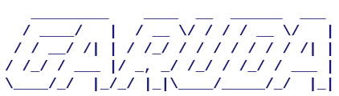
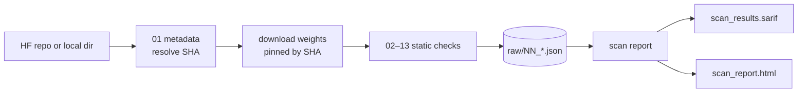

<div align="center">



**Static security scanning for open-source LLMs.**
Inspect a Hugging Face model before it gets anywhere near production — and hand reviewers evidence, not opinions.

[](https://github.com/rajatm91/garuda/actions/workflows/ci.yml)


[Quick start](#quick-start) · [What it checks](#what-it-checks) · [Usage](#usage) · [CI gating](#ci-gating) · [Usage guide](USAGE.md)

</div>

---

## Why Garuda?

Downloading an open-weight model means running someone else's artifacts: pickle files that can execute code on load, custom `*.py` pulled in by `trust_remote_code`, bundled dependencies, licenses with strings attached. Garuda runs a pinned, reproducible battery of static checks over a model repo and produces an **evidence pack** — a SARIF log for your security tooling and a self-contained HTML report you can attach to a review ticket.

- **One command** — `scan all <repo>` fetches, scans and reports.
- **Pinned and reproducible** — branches resolve to a commit SHA; weights are downloaded by SHA; tool versions are recorded.
- **Defense in depth** — 13 steps across malicious payloads, unsafe formats, CVEs, secrets, provenance and shipped code.
- **Soft-fail by design** — a missing optional tool yields a recorded skip, not a broken pipeline.
- **Standard output** — native SARIF 2.1.0 for GitHub code scanning, DefectDojo, Azure DevOps; no-CDN HTML for humans.
- **CI-ready** — `--fail-on error|warning` exit codes and JSON logs.

## Quick start

**Docker (recommended)** — bundles every scanner (syft, grype + cached CVE DB, gitleaks, semgrep, modelaudit):

```bash
docker build -t garuda .

# Hugging Face model
docker run --rm -e HF_TOKEN -v "$PWD/scans":/scans \
  garuda all meta-llama/Llama-3.1-8B-Instruct --out /scans/llama

# Model already on disk
docker run --rm -v /data/models:/models -v "$PWD/scans":/scans \
  garuda all --local-path /models/mymodel --out /scans/mymodel
```

**From source** (Python 3.14+, [uv](https://docs.astral.sh/uv/)):

```bash
git clone https://github.com/rajatm91/garuda.git && cd garuda
uv sync --all-extras
uv run scan all Qwen/Qwen3-8B
```

Then open `scan_<repo>_<UTC>/reports/scan_report.html`.

> Full scans belong in the Docker image: semgrep ships only there, and modelaudit can't analyse weight shards on macOS.

## How it works



`scan static` writes raw tool output; `scan report` translates it into one SARIF log and one HTML report. `scan all` does both.

## What it checks

| # | Check | Tool | Looks for |
|---|---|---|---|
| 01 | Metadata | huggingface_hub | Model info; `--revision` → commit SHA |
| 02 | Hashes | stdlib | SHA-256 of every weight file |
| 03 | Format inventory | stdlib | Pickle-capable formats (`.bin` `.pt` `.ckpt` `.pkl` `.npy` `.keras` …) vs safetensors |
| 04 | Malicious payloads | modelaudit | Code-execution payloads across model formats |
| 05 | Pickle scan | picklescan | Second opinion on pickle imports |
| 06 | Python deps | pip-audit | CVEs in shipped `requirements*.txt` |
| 07 | Licenses | stdlib | LICENSE / NOTICE files + model-card license |
| 08 | SBOM | syft | CycloneDX + SPDX bill of materials |
| 09 | Vulnerabilities | grype | CVEs from the SBOM |
| 10 | Secrets | gitleaks | Leaked keys and tokens |
| 11 | Provenance | huggingface_hub, model-signing | Local vs HF-published hashes, `model.sig` (Sigstore), publisher identity |
| 12 | Shipped code | semgrep | `trust_remote_code` Python: exec/eval, subprocess, network, unsafe deserialization, native loading |
| 13 | HF security scan | Hugging Face API | HF's own AV + pickle-import verdicts at the pinned commit |

## Usage

```bash
scan static <repo> | --local-path <dir>   # run checks → raw/
scan report <scan_dir>                    # raw/ → SARIF + HTML
scan all    <repo> | --local-path <dir>   # both
```

| Option | Applies to | Description |
|---|---|---|
| `--revision REV` | static, all | Branch/tag/SHA to scan (default `main`) |
| `--local-path DIR` / `--repo-id NAME` | static, all | Scan an on-disk model; optional canonical name |
| `--out DIR` | static, all | Output directory (default `scan_<repo>_<UTC>`) |
| `--expect-publisher ORG` | static, all | Error if the repo owner differs |
| `--signer-identity ID --signer-issuer URL` | static, all | Verify `model.sig` against a pinned Sigstore signer |
| `--fail-on {error,warning}` | report, all | Exit `1` if unsuppressed findings at or above that level exist |
| `-v` / `-q` | all commands | Debug logging / warnings only (no banner) |
| `--log-format {text,json}` | all commands | JSON = one object per line on stderr |

### Environment

| Variable | Purpose |
|---|---|
| `HF_TOKEN` | Gated models (Llama, Gemma, some Qwen) |
| `GARUDA_LOG_FORMAT` | `json` to default to JSON logs |
| `GARUDA_IGNORE_FILES` | Comma-separated file names whose findings are suppressed (default `README.md`; empty disables) |
| `GARUDA_SEMGREP_CONFIGS` | Extra semgrep rule packs |
| `GRYPE_DB_AUTO_UPDATE` | `false` to skip the CVE DB refresh (offline) |
| `NO_COLOR` | Disable banner colour |

## Output

```
scan_<repo>_<UTC>/
├── manifest.json              # pipeline state, tool versions, skipped steps
├── raw/                       # 01_metadata.json … 13_hf_security.json (native tool output)
└── reports/
    ├── scan_results.sarif     # one SARIF 2.1.0 log, one run per tool
    └── scan_report.html       # self-contained, attach to a ticket
```

The HTML report opens with a verdict — **FAIL** (any error), **REVIEW** (warnings), **PASS** — followed by findings grouped by tool.

## CI gating

```yaml
- name: Scan model
  env: { HF_TOKEN: "${{ secrets.HF_TOKEN }}" }
  run: uv run scan all "${{ inputs.model }}" --fail-on error --log-format json

- name: Upload SARIF
  if: always()
  uses: github/codeql-action/upload-sarif@v3
  with: { sarif_file: "scan_*/reports/scan_results.sarif" }
```

Exit codes: `0` clean (or no `--fail-on`), `1` findings at/above threshold, `2` invalid invocation or static stage failure. A full workflow is in [USAGE.md](USAGE.md#6-ci-github-actions).

## Scope

Garuda inspects **artifacts**, not behaviour. Not covered: prompt injection, jailbreaks, PII leakage, bias/toxicity, hallucination, CBRN capability probes, training-data extraction, application-layer OWASP LLM risks (output handling, excessive agency, vector stores, unbounded consumption), and performance testing.

<details>
<summary><b>License notes for common model families</b></summary>

- **Llama (Meta)** — Llama Community License (not OSI). Acceptable Use Policy; separate license needed above 700M MAU; no indemnity.
- **Gemma (Google)** — Gemma Terms of Use + prohibited-use policy. Commercial use allowed; derivatives inherit the terms.
- **Qwen (Alibaba)** — varies: many Qwen2.5+ checkpoints are Apache 2.0, some ship under the Tongyi Qianwen License (MAU clause, AUP).

Always attach the model's actual `LICENSE` file to legal review — don't summarise it.

</details>

## Documentation

- [USAGE.md](USAGE.md) — recipes: offline scans, reading outputs, CI, verifying deployed weights, troubleshooting.
- [`docs/superpowers/specs/`](docs/superpowers/specs/) — design spec (static-stage invariants; dynamic-stage sections are obsolete).

## Development

```bash
uv sync --all-extras
uv run pytest                 # unit tests
uv run pytest -m integration  # integration tests
uv run ruff check . && uv run pyright
```

Conventions: numbered `raw/NN_<tool>.*` filenames are a load-bearing contract; every step soft-fails to a `{"skipped": ...}` stub; the HTML report stays dependency-free. See [CLAUDE.md](CLAUDE.md) for architecture notes.
